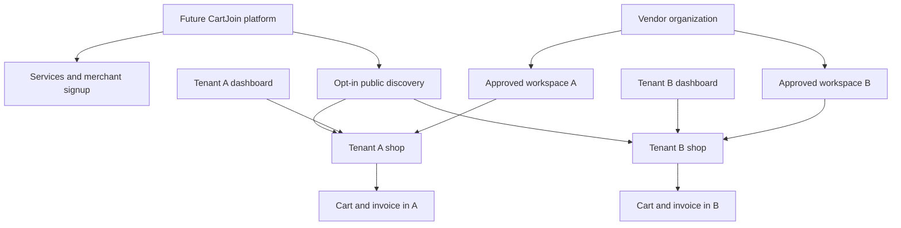
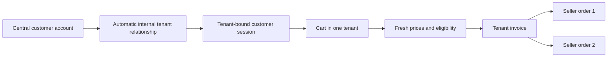

> **Proposed architecture, not implemented by this roadmap.** Tenant isolation is a release condition for every phase.

## Five surfaces, distinct responsibilities

| Surface | Audience and purpose | Data boundary |
|---|---|---|
| Tenant storefront: `CartJoin-Storefront-Frontend` | Customers browse and purchase from the resolved tenant | That tenant's published content and authorized customer commerce |
| Tenant dashboard | Tenant owner and staff operate the business | One tenant plus staff permissions |
| Vendor dashboard | Vendor staff work in approved stores | Authenticated vendor + approved active tenant |
| Platform admin dashboard | Authorized platform operations and investigation | Explicit platform permissions; not an unrestricted replacement for tenant workflows |
| Future CartJoin platform interface | Services, plans, merchant signup and later public discovery/customer account | Platform-owned public content and approved discovery projections; private tenant records remain behind tenant authorization |

The future interface is separate frontend work. Do not add CartJoin packages, cross-store product grids or platform signup flows to the tenant storefront. Shared UI libraries are possible; shared runtime tenant data is not implied.

## Identity is not customer-data ownership

**Confirmed requirement: one centralized customer account, usable in every tenant storefront without registering again.** The same credentials identify the person everywhere. A store relationship is created internally and idempotently on first authorized interaction; it is not a second account, password or signup. Each store retains its relationship state, consent and commercial history.

| Information | Recommended owner/scope | Sharing rule |
|---|---|---|
| Global identity and credential/recovery factors | Central customer account domain | Never exposed to tenant staff |
| Tenant customer relationship | One tenant + centralized customer account | A merchant can access only its own relationship |
| Orders, invoices, payment attempts and returns | Original tenant and recorded customer | Never transferred merely because identities are linked |
| Wallet, gift-card value, points and customer groups | Existing tenant/currency/program context | No automatic cross-store balance or eligibility |
| Global address vault, if introduced | Customer-controlled platform feature | Explicitly selected details become tenant order snapshots during checkout |
| Marketing preferences | Separate global and per-tenant purposes | Global sign-in is not consent to every merchant's campaigns |
| Global purchase overview, later | Authorized customer-only projection | Fetch only that person's linked relationships; no merchant cross-store access |

Target one canonical centralized customer account with one credential/recovery lifecycle, plus optional tenant relationship records for store-specific attributes. Preserve legacy tenant-scoped `User` records during a staged migration and link their historical commerce safely. Do not create a new credential-bearing customer record for every store. Logical concepts are a central account, tenant relationship and verified legacy mapping; exact tables and JWT changes require a separate design review.

## Customer tenant_id means signup origin only

The product owner requires the centralized customer to retain a field named `tenant_id` **only to record the tenant where the customer first registered**. It is attribution, not ownership, membership, active workspace or an authorization boundary.

| Event | Central customer tenant_id | Active commerce context |
|---|---|---|
| First signup through tenant A | A, set by the server | A |
| Same customer signs in or buys in B | Still A; no new registration | B, independently resolved |
| Future signup through the global CartJoin site | Null; source is platform signup | No tenant until a shop is entered |
| The original tenant closes | Account must survive; preserve lawful attribution or null the reference according to the approved retention design | Other tenant relationships remain valid |

Keep the value immutable through normal profile updates. Never derive the active tenant from this field, filter global login by it, accept it from a signup form body, or cascade-delete the global customer when the origin tenant is deleted. A separately recorded acquisition source can distinguish platform signup and migration without inventing a tenant.

Cart, order, invoice, address snapshot, balance and tenant relationship `tenant_id` fields retain **ownership/isolation semantics**. The same field name on the central account has a deliberately different meaning that must be documented in models, resources and reporting. The current scoped `User` cannot simply be unscoped in place before every consumer is audited. Migration must separate origin attribution from authorization and preserve legacy references.

A tenant may see its own signup-attribution aggregates and its own customer relationships, not browse global customers by manipulating an origin filter. Platform-wide attribution reporting requires explicit administrative permission.

## Tenant resolution and authorization rules

- Derive tenant context from trusted routing/session infrastructure. Never trust a tenant ID supplied in a product, cart or checkout form.
- Domain/subdomain routing must use an approved host-to-tenant mapping. Reject unknown or conflicting context; never silently fall back to a default store.
- A centralized login must exchange or establish a tenant-bound customer session before private store operations. A global discovery session is not a tenant admin/vendor/customer authorization shortcut.
- Wrong-tenant resource access remains 404. A legitimate in-scope record with insufficient action permission is a separate authorization decision.
- Cache keys, search indexes, uploads, signed media links, exports, jobs, events and webhook delivery must preserve scope. A global customer ID alone is not a tenant cache key.
- Keep SKU, slug and coupon uniqueness tenant-scoped. Global discovery uses its own stable references to the original tenant offer.
- Vendor workspace approval and vendor ownership remain mandatory even when the vendor has a global public profile.

## Customer and order flow

Central customer authentication is an early foundation requirement and does not depend on a global CartJoin website. An existing customer can sign in at another tenant immediately without a registration form. Internal relationship creation must not subscribe the person to marketing or transfer another store’s data. Later discovery can send visitors to the tenant shop. Neither flow changes the owning tenant of a purchase. Revalidate offer availability, seller approval, currency, price and delivery eligibility in the target tenant before purchase.

## Non-goals and release evidence

No unscoped global queries over private tenant customer/order tables, shared wallet, cross-tenant invoice, automatic account merging or global vendor access to every store. Test host spoofing, wrong-tenant IDs, cached responses, signed files, queued jobs and stale discovery links before release. Document an explicit authorized platform path for each legitimate cross-tenant administrative operation.

Source baseline: TenantSetting, tenant-scoped User, TenantContext infrastructure and Invoice checkout. See [current ownership rules](/en/business), [identity migration](/en/roadmap/global-platform) and [release gates](/en/roadmap/phases).
