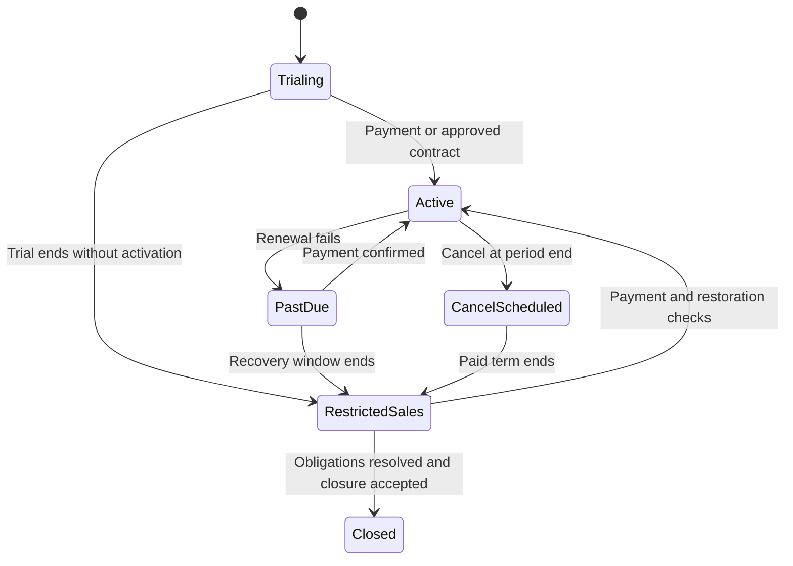

> **Development status · 18 November 2026.** Central customer login, canonical commerce-mode checks, versioned test billing and assisted merchant applications now have implementation and test evidence. The separate platform frontend has package comparison and application screens. Later operational/discovery gates remain tracked work, and nothing here claims a live deployment. [Current billing guide](/en/features/subscriptions) · [Application guide](/en/features/merchant-onboarding).

> **Proposed commercial policy.** Package names are working labels. No prices, payment provider, tax treatment or signed terms are established here.

## Recommended revenue model

Use a tenant subscription as the predictable base. Offer advanced automation, additional capacity and marketplace capabilities as transparent packages or add-ons. Do not impose a default platform percentage on every merchant sale in the first release. Optional platform transaction/service fees require a clearly priced service, explicit acceptance and separately reported attribution.

This gives merchants a calculable cost while allowing CartJoin to monetize higher operational value. It is a positioning hypothesis to validate with merchants, not a claim of guaranteed competitive advantage.

| Working package | Intended merchant | Capability direction |
|---|---|---|
| Store Starter | Independent business launching its own offers | Store commerce, essential content, staff and operational reporting |
| Store Growth | Merchant improving conversion and operations | Higher capacity and validated editor, recovery, analytics or connector capabilities |
| Marketplace | Business hosting approved external sellers | Store foundation plus vendor lifecycle, moderation, commission and settlement tools |
| Enterprise | Negotiated operating requirements | Versioned custom terms, capacity, service commitments and integrations |

Do not advertise a capability in a package before its release gate passes. Use plan versions so changing a catalog price does not rewrite a merchant's accepted terms.

## Keep four money flows separate

| Flow | Payer → recipient | Records and boundary |
|---|---|---|
| Platform subscription/add-on | Tenant → CartJoin | Platform billing invoice and subscription ledger; not a customer purchase invoice |
| Product purchase | Customer → the agreed tenant/seller payment arrangement | Existing tenant purchase, payment and refund flow |
| Marketplace commission | Vendor earnings → tenant marketplace under agreed terms | Tenant-vendor commission and settlement records |
| Optional vendor subscription | Vendor → tenant marketplace by default | Later tenant-owned vendor plan/receipt; not a global CartJoin vendor charge |

Any optional CartJoin service fee must identify its contracting party, basis, exclusions, refund handling and recipient. Never deduct it invisibly from the tenant's vendor commission. Global vendor participation in two stores does not create an automatic double charge. Merchant-of-record and invoicing responsibilities must be validated before commercial launch; global discovery does not transfer those responsibilities to CartJoin by itself.

## Entitlements and usage

Store the accepted plan version, effective dates, allowed mode/capabilities and capacity policy. Owning modules enforce limits when creating new usage, including concurrent API requests, bulk imports and jobs. Staff permissions remain an additional requirement.

| Usage | Proposed counting rule |
|---|---|
| Products | Non-archived parent products, including drafts; variant/SKU capacity separately defined |
| Staff seats | Active authorized staff; invitation reservations need an explicit expiry policy |
| Vendors | Approved active tenant-vendor relationships; approval is checked atomically |
| Storage | Measured managed bytes under a documented original/derived-media rule; retained financial evidence cannot be deleted to satisfy a limit |
| Automation/messages | Delivered/attempted unit and provider cost defined explicitly before pricing |

Notify before a limit is reached, show current usage and the remediation path. No silent overage billing. Plan expiry or lower limits must not delete data or reprice past purchases. Capacity reductions block new usage where necessary and offer cleanup or upgrade choices.

## Subscription lifecycle

Proposed initial policy: a configurable 14-day trial, no automatic charge without accepted authorization, and a configurable renewal recovery window. Exact grace duration, reminder timings, fees and retry schedule are Phase 0 commercial decisions.

These are conceptual states, not approved database enum values. **Billing restriction is different from security suspension.** A subscription problem should stop new commercial exposure while preserving an explicitly authorized path to fulfill existing orders, handle returns/refunds, access billing and resolve vendor money. Existing hard tenant suspension must not be repurposed blindly for dunning. Security suspension remains a separate immediate control with audited remediation.

## Changes, failure recovery and acceptance

- Upgrades show a server-calculated effective date and any proration preview before acceptance. Apply new paid entitlements only on confirmed payment or a recorded authorized credit/contract.
- Schedule downgrades for renewal after usage and obligation checks. Refer to the stricter [mode downgrade rules](/en/roadmap/modes) when leaving Marketplace.
- Version payment attempts and validate webhook authenticity. Retries must not duplicate invoices, charges or entitlement activation.
- Record billing success with provisioning failure as an exception that can be retried or compensated. Never silently grant access from a browser redirect alone.
- Retain subscription invoices and original accepted plan terms when a package is retired. Cancellation, refund and data-retention policies need approved terms before release.

Release evidence must include concurrent limit checks, failed renewal and recovery, webhook replay, cancelled upgrade, stale quote, paid-but-unprovisioned recovery and servicing of existing purchases under billing restriction. See [phases](/en/roadmap/phases) and [open commercial decisions](/en/roadmap/decisions).
