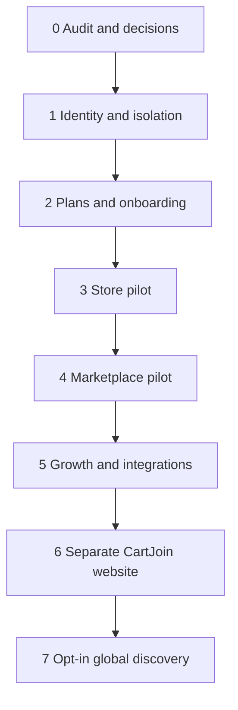

> **Published development checkpoint · 19 November 2026.** Central customer login, verified global signup and tenant-neutral recovery, commerce-mode checks, versioned test billing and assisted merchant applications are implemented. Published work also includes physical confirmation, later-paid COD reward/refund reconciliation, marketing choices, opt-in discovery and private customer purchase summaries. The bounded cart-recovery backend and tenant screen are published; English/Arabic media verification is still in progress. Full phase acceptance, remaining analytics/integration work and live deployment are separate gates. [Billing](/en/features/subscriptions) · [Merchant applications](/en/features/merchant-onboarding) · [Global accounts](/en/features/global-customer-account) · [Cart recovery](/en/features/cart-recovery).

> **Roadmap and release gates.** Development delivery is described above. The phases below retain the operational and commercial acceptance gates; source completion does not imply a live pilot or deployment.

> **Provider development checkpoint · 18 November 2026.** Guarded customer payment simulation, signed test tracking/private test labels and encrypted local SMS delivery are implemented. Customer payment/invoice/refund regression:251 passed; focused outcome/display checks17 passed. English/Arabic success and decline were exercised in the browser. This closes adapter development work, not live carrier or payment readiness. [Payment preview](/en/features/payments).

## Delivery order

**Marketplace development checkpoint · 18 November 2026:** policy publication
and version-specific acceptance, immutable case conversations, explicit reviews,
vendor appeals, reviewer assignment and eight evidence queues are implemented
across backend, tenant, vendor and admin. [Guide and walkthroughs](/en/features/marketplace-operations).
Product submission, correction, resubmission, immutable review receipts, dedicated
publisher authority and safe import reports are now implemented and tested across
the three staff dashboards. [Product review guide](/en/features/product-review).
This does not close the phase. The current checkpoint adds retained
carrier-to-order lifecycle integration; measurable dispatch performance and
operational pilot acceptance still need evidence. Marketing consent and discovery
publication controls are foundations, not completion of the whole growth phase.

**Fulfillment development checkpoint:** packing, retained carrier evidence and
quantity-based physical assessment are implemented. Durable sequential order
receipts, queued reconciliation and replay-safe event publication now have
controlled integration tests. Explicit store confirmation and customer partial
progress are implemented alongside the staff screens. Delayed events retain the
status recorded at the time of the decision. Automatic execution remains
**disabled by default**; activation needs its own reviewed gate, independent of
the code checkpoint and final cross-dashboard/browser acceptance.
A partial delivery, editable status or vendor claim cannot complete the whole
order; test evidence cannot fill missing live deliveries, and unknown dispatch
time stays unknown. Physical delivery does not itself collect COD or grant an
unsettled purchase reward.
[Current packing guide](/en/features/packing).

**Review reminder checkpoint:** requests now retain a due date and acknowledgement
for each shop and order. Duplicate delivery events cannot send a reminder early
or create another accepted notification. Requests wait at least three days,
recheck the purchase and remaining reviews, and use the customer's English/Arabic
preference. Test deliveries cannot earn a verified-purchase badge. Transport
recovery and an operator retry screen remain work; this is not a live email
acceptance claim. [Review guide](/en/features/reviews).

**COD dispatch checkpoint:** internal wallet, gift-card and points commitments
are now atomic with stock preparation; exact amount/expiry checks block stale
credit, and cash remains unpaid until collection. Replacement payment attempts
are blocked after retained handoff. Durable reward reconciliation now handles
later-paid COD, cumulative money-and-tax refunds, zero-point qualifying spend,
first-order bonuses, floor limits and protected attached authorizations. Capped
clawback blocks new redemptions pending operator review. New checkout snapshots
share a versioned actual-paid item basis; older snapshots retain declared
compatibility rules. Retaining an expired authorization never reauthorizes
capture. [Payment rules](/en/features/payments) · [Reward reconciliation](/en/features/loyalty) · [Refunds](/en/features/refunds).

**Consent and cart-recovery checkpoint · 19 November 2026:** customers can
independently grant or withdraw offers and cart-reminder permission for each store
and channel in English or Arabic. Defaults are off and changes retain their notice
version. The bounded cart-recovery backend and tenant operator screen are now
published. The default-off pilot records observed buyer actions, rechecks current
consent, verified contact, account/local access, cart and purchase eligibility,
uses checkout-location stock, and retains suppression, bounded retries, attention
and expiry. Its dedicated guarded adapter records local test acceptance only;
there is no claim of external delivery or attributed recovered revenue. The
English/Arabic media checkpoint is still being completed.
[Customer choices](/en/features/marketing-consent) · [Cart recovery](/en/features/cart-recovery).

**Separate platform and discovery checkpoint:** package comparison and merchant
applications are joined by reviewed store/offer publication, workspace-specific
vendor opt-in and public store/product/seller discovery. Existing customers can
sign in and view only their own cross-store purchase summary. Each checkout and
financial balance remains at its tenant. Verified global customer signup and
tenant-neutral recovery now have their own [account flow](/en/features/global-customer-account).
Automatic cross-domain SSO and shared cross-tenant checkout remain outside this scope.
[Discovery controls](/en/features/global-discovery) · [Private purchases](/en/features/cross-store-purchases).

Central customer identity belongs in the foundation. The separate global CartJoin website can arrive later without requiring customers to register again at each shop.

## Phase 0 — Audit and approve the operating model

**P0 · Product owner, engineering lead and operations.** Inventory implemented behavior across backend and all four frontends. Record source revisions, routes, settings, missing paths and actual financial responsibilities. A scaffold or setting is not a completed feature.

Audit customer uniqueness, verified identifiers, duplicates, credentials, JWT claims, every consumer of `User.tenant_id`, foreign keys, deletion cascades, reports, exports and customer search. Distinguish reliable first-signup evidence from historical ownership fields; do not fabricate attribution when evidence is missing.

**Exit:** signed decisions, model/capability matrix, migration reconciliation plan, explicit pricing and billing policies, scoped pilot and measurable acceptance criteria. Resolve seller/invoice responsibility and operational ownership before taking money under new terms.

## Phase 1 — Central identity and tenant-safe capabilities

**P0 · Identity, backend and frontend owners · depends on Phase 0.** One customer account authenticates at every eligible tenant. Create internal customer–tenant relationships automatically and idempotently. Keep customer `tenant_id` as original signup attribution only; global-origin signup may use null. Preserve tenant ownership on commerce records.

Introduce a canonical Store/Marketplace capability policy with plan, tenant status, permissions and vendor approval checks. Audit server requests, background jobs, cache keys, search, exports and media. Keep the tenant storefront isolated; do not add global discovery to it.

**Exit:** proven cross-store login without another registration, verified legacy ID mapping, no unsafe account merges, wrong-tenant resource responses of 404, and no regression in tenant commerce boundaries. Reconcile old and migrated counts before switching reads. Rollback must preserve newly created account and order mappings; never restore an old database over live purchases.

## Phase 2 — Plans and guided activation

**P0 · Billing, product and operations · depends on Phase 1.** Build versioned packages, usage limits, subscription states, platform billing records, assisted merchant onboarding and recoverable provisioning. Distinguish platform subscription invoices from customer purchase invoices and vendor commissions.

Support explicit upgrade quotes, confirmed activation, scheduled downgrades and restricted-sales servicing. Document grace periods, trial end, retries, notices and authorized manual overrides before launch.

**Exit:** duplicate payment events cannot double-charge or provision twice; paid-but-unprovisioned accounts reach a visible exception queue; restrictions preserve authorized refunds, fulfillment and reconciliation. Test activation and recovery using provider test environments during implementation.

## Phase 3 — Store pilot

**P0 · Storefront, catalog, payment and fulfillment owners · depends on Phase 2.** Pilot tenant-owned inventory and the full customer journey: browse, sign in, cart, fresh quote, checkout, payment, dispatch, return and refund. Validate guest checkout only where enabled and end-to-end supported. Improve existing CMS with draft, preview and publication controls rather than assuming it is absent.

Manual shipping can support an explicitly described assisted pilot. A claim of live carrier integration requires verified booking, labels, tracking, cancellation and exception recovery with an actual provider.

**Exit:** pilot operators can complete and reconcile real permitted workflows; stock/payment retries remain idempotent; English, Arabic, mobile and accessibility review passes. Record checkout completion and exceptions against an agreed baseline.

## Phase 4 — Marketplace pilot

**P0 core / P1 efficiency · Marketplace and finance owners · depends on Phase 3.** Activate approved vendors per tenant, seller terms, offer publication, tenant invoice/vendor order splits, commission policies, returns, settlements and payout exceptions. Add seller dispatch and cancellation monitoring with review and appeal.

**Exit:** a vendor sees only its approved workspace and own records; ledger totals reconcile to orders, refunds and payouts; suspension and mode downgrade preserve outstanding obligations. Exercise unresolved returns, negative balances and payout failure before expanding the pilot.

## Phase 5 — Growth and monitored connectors

**P1 · Growth, integrations and analytics owners · depends on stable pilots.** Add consent-aware recovery, measured funnels, reliable webhook delivery, usage reporting and operational dashboards. Prioritize improvements using pilot evidence rather than feature count.

**Current boundary:** tenant/purpose/channel consent and the bounded test-only
cart-recovery backend and tenant operator screen are published. Their media
checkpoint remains in progress; this does not complete live campaign delivery.
Retained-fact funnels and purchase cohorts remain feature work: separate signup
origin, store relationships and purchases, exclude canonical test facts and never
invent historical browsing or abandonment. Period dispatch/cancellation KPI
coverage still needs source and acceptance confirmation; per-order monitoring
already exists. Review-reminder transport recovery and an operator retry screen
remain explicit feature work. Existing webhook and billing-notice retry
infrastructure still needs relevant connector end-to-end and operational
acceptance. Storage-byte and automation/message metering are proposed capacity
extensions, not current package billing promises. Concurrent appearance and
feature-policy coverage needs its own checkpoint. Live provider activation and
final cross-dashboard/mobile/accessibility acceptance remain separate gates.

**Exit:** marketing consent is scoped by tenant and purpose, retries are bounded and observable, secrets remain private, and attribution separates first signup from later transactions. Tenant reporting never exposes another tenant's customer activity.

## Phase 6 — Separate CartJoin acquisition website

**P2 · Platform frontend and commercial owners · depends on proven onboarding/billing contracts.** Create a new global interface for CartJoin services, packages, subscriptions and tenant applications. Reuse central identity and provisioning contracts; do not repurpose `CartJoin-Storefront-Frontend`.

**Current boundary:** the separate platform already provides the development
package/application journey, existing-customer sign-in, verified phone-first
registration and tenant-neutral password recovery. Registration creates no usable
customer before proof and no fictitious origin tenant or store membership.
The bounded development verification adapters remain test-only; provider
activation is separate. Shared credentials do not imply automatic browser SSO.
[Account guide and actual walkthrough](/en/features/global-customer-account).

**Exit:** public package information matches versioned billing offers; applications recover from partial provisioning; merchant administration remains distinct from customer login. Existing tenant shops continue independently.

## Phase 7 — Opt-in global discovery

**P2 · Discovery and trust owners · depends on Phase 6 and publication controls.** Expose eligible public stores, vendors and offers with explicit approval. Send shoppers to the chosen tenant's checkout. A customer-only consolidated purchase overview can follow after privacy and authorization review.

**Current boundary:** explicit store/vendor consent, independent store/offer
review and the private customer purchase overview are implemented in development.
The remaining gate is monitored acceptance of domain ownership, changed-content
re-review, opt-out/suspension removal, stock/price freshness and tenant checkout
handoff under real operating conditions. Publication controls do not establish a
live search-index freshness guarantee or close the commercial pilot.

**Exit:** opt-out, suspension, price changes and inventory changes propagate through a measured removal/update process. Recheck availability and price at the tenant checkout. Private customer records never enter the public index.

## Remaining release acceptance

Commercial release also requires approved prices, billing/tax responsibilities,
grace/reminder/retry terms, named operational owners and provider-specific
acceptance. These are decisions and release gates, not inferred production
capabilities. The authorized development finish remains tested code and docs;
live deployment is separate.

## Expansion requires a separate decision

Cross-tenant checkout, shared monetary balances, common product ownership, POS, B2B and autonomous AI are not committed phases. Each requires validated demand, a business case, operational owners and its own data/financial rules. A shared account alone does not justify shared money or orders.

## Release and rollback discipline

Each phase needs a named accountable owner, approved scope, source baseline, migration rehearsal, operational runbook, acceptance evidence and a controlled pilot. Required checks are execution work for the later implementation, not claims that the planned behavior has been tested now.

Roll out capabilities gradually. Stop new activation when reconciliation or isolation fails, preserve historical access for authorized servicing, and replay recoverable jobs only with idempotency keys. Do not roll back by deleting financial evidence or converting vendor-owned history into tenant-owned history.
