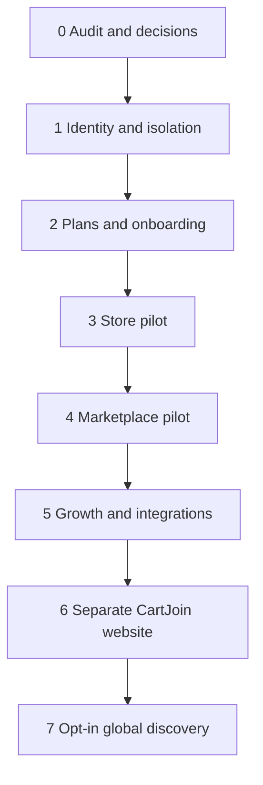

> **Development status · 18 November 2026.** Central customer login, canonical commerce-mode checks, versioned test billing and assisted merchant applications now have implementation and test evidence. The separate platform frontend has package comparison and application screens. Later operational/discovery gates remain tracked work, and nothing here claims a live deployment. [Current billing guide](/en/features/subscriptions) · [Application guide](/en/features/merchant-onboarding).

> **Roadmap and release gates.** Development delivery is described above. The phases below retain the operational and commercial acceptance gates; source completion does not imply a live pilot or deployment.

> **Provider development checkpoint · 18 November 2026.** Guarded customer payment simulation, signed test tracking/private test labels and encrypted local SMS delivery are implemented. Customer payment/invoice/refund regression:251 passed; focused outcome/display checks17 passed. English/Arabic success and decline were exercised in the browser. This closes adapter development work, not live carrier or payment readiness. [Payment preview](/en/features/payments).

## Delivery order

Central customer identity belongs in the foundation. The separate global CartJoin website can arrive later without requiring customers to register again at each shop.

## Phase 0 — Audit and approve the operating model

**P0 · Product owner, engineering lead and operations.** Inventory implemented behavior across backend and all four frontends. Record source revisions, routes, settings, missing paths and actual financial responsibilities. A scaffold or setting is not a completed feature.

Audit customer uniqueness, verified identifiers, duplicates, credentials, JWT claims, every consumer of `User.tenant_id`, foreign keys, deletion cascades, reports, exports and customer search. Distinguish reliable first-signup evidence from historical ownership fields; do not fabricate attribution when evidence is missing.

**Exit:** signed decisions, model/capability matrix, migration reconciliation plan, explicit pricing and billing policies, scoped pilot and measurable acceptance criteria. Resolve seller/invoice responsibility and operational ownership before taking money under new terms.

## Phase 1 — Central identity and tenant-safe capabilities

**P0 · Identity, backend and frontend owners · depends on Phase 0.** One customer account authenticates at every eligible tenant. Create internal customer–tenant relationships automatically and idempotently. Keep customer `tenant_id` as original signup attribution only; global-origin signup may use null. Preserve tenant ownership on commerce records.

Introduce a canonical Store/Marketplace capability policy with plan, tenant status, permissions and vendor approval checks. Audit server requests, background jobs, cache keys, search, exports and media. Keep the tenant storefront isolated; do not add global discovery to it.

**Exit:** proven cross-store login without another registration, verified legacy ID mapping, no unsafe account merges, wrong-tenant resource responses of 404, and no regression in tenant commerce boundaries. Reconcile old and migrated counts before switching reads. Rollback must preserve newly created account and order mappings; never restore an old database over live purchases.

## Phase 2 — Plans and guided activation

**P0 · Billing, product and operations · depends on Phase 1.** Build versioned packages, usage limits, subscription states, platform billing records, assisted merchant onboarding and recoverable provisioning. Distinguish platform subscription invoices from customer purchase invoices and vendor commissions.

Support explicit upgrade quotes, confirmed activation, scheduled downgrades and restricted-sales servicing. Document grace periods, trial end, retries, notices and authorized manual overrides before launch.

**Exit:** duplicate payment events cannot double-charge or provision twice; paid-but-unprovisioned accounts reach a visible exception queue; restrictions preserve authorized refunds, fulfillment and reconciliation. Test activation and recovery using provider test environments during implementation.

## Phase 3 — Store pilot

**P0 · Storefront, catalog, payment and fulfillment owners · depends on Phase 2.** Pilot tenant-owned inventory and the full customer journey: browse, sign in, cart, fresh quote, checkout, payment, dispatch, return and refund. Validate guest checkout only where enabled and end-to-end supported. Improve existing CMS with draft, preview and publication controls rather than assuming it is absent.

Manual shipping can support an explicitly described assisted pilot. A claim of live carrier integration requires verified booking, labels, tracking, cancellation and exception recovery with an actual provider.

**Exit:** pilot operators can complete and reconcile real permitted workflows; stock/payment retries remain idempotent; English, Arabic, mobile and accessibility review passes. Record checkout completion and exceptions against an agreed baseline.

## Phase 4 — Marketplace pilot

**P0 core / P1 efficiency · Marketplace and finance owners · depends on Phase 3.** Activate approved vendors per tenant, seller terms, offer publication, tenant invoice/vendor order splits, commission policies, returns, settlements and payout exceptions. Add seller dispatch and cancellation monitoring with review and appeal.

**Exit:** a vendor sees only its approved workspace and own records; ledger totals reconcile to orders, refunds and payouts; suspension and mode downgrade preserve outstanding obligations. Exercise unresolved returns, negative balances and payout failure before expanding the pilot.

## Phase 5 — Growth and monitored connectors

**P1 · Growth, integrations and analytics owners · depends on stable pilots.** Add consent-aware recovery, measured funnels, reliable webhook delivery, usage reporting and operational dashboards. Prioritize improvements using pilot evidence rather than feature count.

**Exit:** marketing consent is scoped by tenant and purpose, retries are bounded and observable, secrets remain private, and attribution separates first signup from later transactions. Tenant reporting never exposes another tenant's customer activity.

## Phase 6 — Separate CartJoin acquisition website

**P2 · Platform frontend and commercial owners · depends on proven onboarding/billing contracts.** Create a new global interface for CartJoin services, packages, subscriptions and tenant applications. Reuse central identity and provisioning contracts; do not repurpose `CartJoin-Storefront-Frontend`.

**Exit:** public package information matches versioned billing offers; applications recover from partial provisioning; merchant administration remains distinct from customer login. Existing tenant shops continue independently.

## Phase 7 — Opt-in global discovery

**P2 · Discovery and trust owners · depends on Phase 6 and publication controls.** Expose eligible public stores, vendors and offers with explicit approval. Send shoppers to the chosen tenant's checkout. A customer-only consolidated purchase overview can follow after privacy and authorization review.

**Exit:** opt-out, suspension, price changes and inventory changes propagate through a measured removal/update process. Recheck availability and price at the tenant checkout. Private customer records never enter the public index.

## Expansion requires a separate decision

Cross-tenant checkout, shared monetary balances, common product ownership, POS, B2B and autonomous AI are not committed phases. Each requires validated demand, a business case, operational owners and its own data/financial rules. A shared account alone does not justify shared money or orders.

## Release and rollback discipline

Each phase needs a named accountable owner, approved scope, source baseline, migration rehearsal, operational runbook, acceptance evidence and a controlled pilot. Required checks are execution work for the later implementation, not claims that the planned behavior has been tested now.

Roll out capabilities gradually. Stop new activation when reconciliation or isolation fails, preserve historical access for authorized servicing, and replay recoverable jobs only with idempotency keys. Do not roll back by deleting financial evidence or converting vendor-owned history into tenant-owned history.
