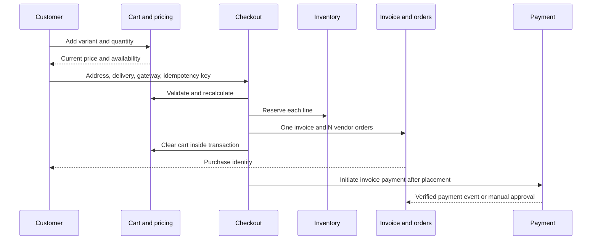
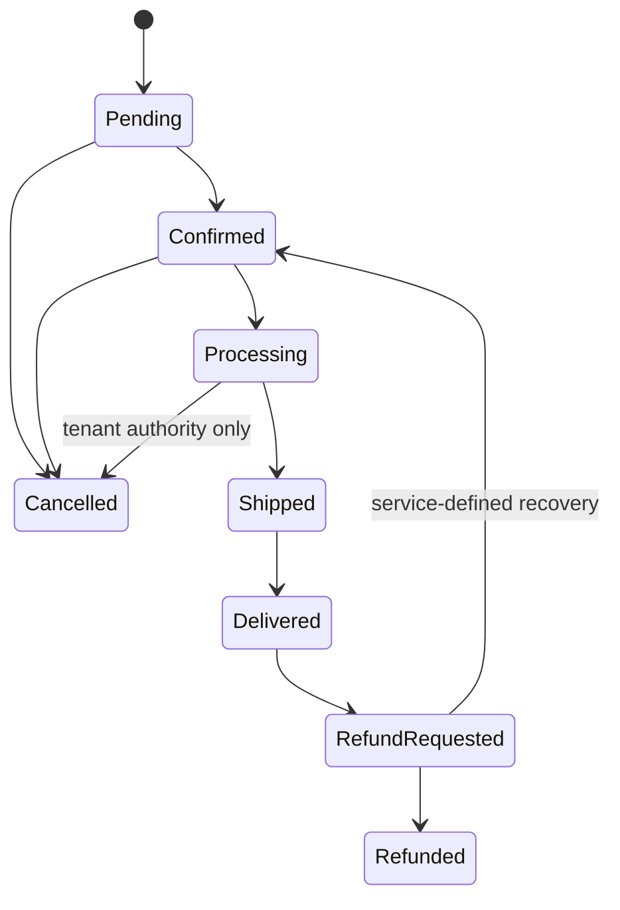

## A concrete example

A customer buys one item from vendor A and two from vendor B in the same tenant storefront. The cart remains one cart. Checkout creates one invoice and two orders. Each vendor fulfills only its order; the customer follows both from the purchase context. This does not require a second checkout.

## Connect the steps to the screen

<SystemTour tour="orders" compact />

## Handoffs and failure boundaries

| Stage | Owner | Output | If it cannot proceed |
|---|---|---|---|
| Discovery | Customer + published catalog | Chosen variant | Recheck filters/publication |
| Cart | Customer + pricing | Recalculated lines and totals | Resolve stock/eligibility messages |
| Checkout | Invoice orchestration | One invoice, N orders and reservations | Failed placement must not leave partial purchase records |
| Payment | Provider or authorized tenant approver | Captured or waiting/failed state | Inspect attempt; do not trust redirect |
| Fulfillment | Tenant/vendor | Status and parcel history | Use permitted transition, investigate carrier state |
| Delivery | Fulfillment integration | Delivery evidence | Enables eligible after-sales/earning workflows |

This is the order service’s transition map, not a statement that every actor can use every edge. Vendor cancellation excludes Processing. Customer cancellation is through the invoice’s eligible child-order action. Platform order oversight is read-only.

See [cart](/en/features/cart), [checkout](/en/features/checkout), [orders](/en/features/orders), [payments](/en/features/payments) and [shipping](/en/features/shipping).
