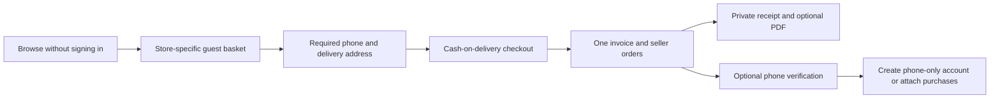

## For customers: prepare your basket

Browse Shop or a product page and choose **Add to cart**. You do not need an account. Open **Cart** to change quantities or remove items. Your basket belongs to this store and browser, and expires after seven days. Prices, delivery charges and stock are checked again before purchase.

## Buy without an email address

Open **Checkout**, enter the recipient name, delivery address and a valid **phone number**. Email is optional. Choose an available delivery option and **Cash on delivery**, then review the final invoice total before placing the order. Guest checkout must be enabled for the store. If it is disabled, sign in to purchase; the basket can still be prepared as a guest.

Guests cannot use account wallets, loyalty points, gift cards or coupons. Sign in to use eligible account benefits and other payment methods. Signing in adds the guest basket to the account basket using current stock and pricing checks. It does not attach previous guest purchases without phone verification.

## Keep the receipt or create an account afterward

The confirmation screen shows the invoice and seller orders. Save the invoice PDF. The browser's private guest access expires after seven days; do not share the browser or its shopping token. Cross-device receipt recovery by SMS is not part of this release.

Choose **Save your purchases to an account** if wanted. Request a code sent to the purchase phone. Enter the six-digit code. For a new account, choose a password with at least ten characters; no email is required. If that phone already belongs to an account, leave the new-password field empty: verification attaches these purchases and leaves the existing password unchanged. Sign in with the phone and password afterward. Guest access is revoked after a successful claim. Creating an account is optional and does not change the placed order.

## For tenant admins: control guest purchasing

Open **Storefront → Settings → Guest checkout**. **Allow eligible guest purchases** is on by default. Save the setting to change it. Switching it off blocks new guest purchases, while customers can still build baskets and open existing receipts for the remaining access period. Ensure cash on delivery and appropriate shipping methods are available before inviting customers to use guest checkout. Phone verification requires the configured SMS service and a running notification queue.

Open a seller order as usual. The **Guest purchase** badge remains after the customer claims the order. Use the delivery contact from the order to arrange fulfillment; an absent email is expected. Guest orders do not earn loyalty points retrospectively.

## For platform admins and vendors

**Platform admins:** select the tenant in **Storefront settings** to inspect its guest-checkout setting. This oversight screen is read-only. Orders show the guest-purchase badge and the existing invoice/payment status. New and edited staff accounts require a phone; email is optional. Staff sign-in supports phone and password, with existing email/username access retained where supported.

**Vendors:** select the approved store workspace, then open **Orders**. The guest-purchase badge identifies the checkout route; fulfillment, stock, commission and settlement rules stay the same. Buyer email and phone remain redacted on the vendor surface. Use the permitted order/shipping information and the store's operational process. Vendor staff now have a required login phone separate from an optional address phone. Email invitations still need an email destination.

## Business and data flow

The server calculates prices, taxes, stock reservations and seller splits. A phone typed at checkout is a contact detail, not proof of account ownership. Only a valid purchase-phone code and the owning guest access can claim purchases. Unknown, expired or wrong-store access does not reveal orders.

## Review notes

This guide describes the guest-checkout implementation in the current source branch. Local demonstrations use seeded data. Real SMS delivery depends on deployment configuration; no demo verification bypass is included. See [Cart](/en/features/cart), [Checkout](/en/features/checkout) and [the customer handbook](/en/roles/customer).
