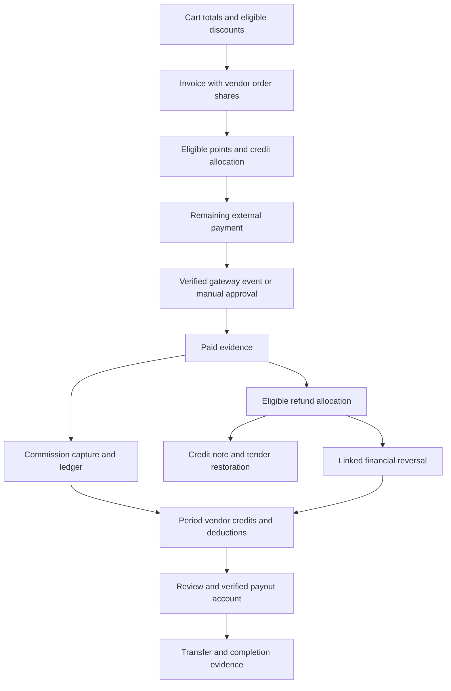

## Keep the money concepts separate

Cart discounts reduce the price. Gift-card and wallet tenders contribute value toward payment; loyalty redemption follows its program rules. The remaining external amount is initiated against the invoice. A paid invoice does not mean the vendor has received a payout.

## Connect the steps to the screen

<SystemTour tour="customer" compact />

## Bank transfer and COD

Bank transfer moves from awaiting confirmation to pending approval when proof is uploaded. A named tenant approver accepts the capture or rejects it back to awaiting confirmation. COD skips proof and requires a collection action. Online success comes from a verified callback. None of these is inferred from a support ticket.

## Refund example

Suppose one invoice paid 300 in one currency and contains an order worth 100 and another worth 200. The first order cannot be refunded for 150 merely because the shared payment has enough total value. Pending refunds already consume headroom. A full 100 refund for the first order still leaves the shared payment only partially refunded.

## Settlement and payout

A settlement groups immutable credits/deductions for one vendor, tenant, currency and period. Closure fixes the lines. Approval requires a verified destination; one payout is created in the MVP. Negative or below-minimum net carries forward. A retry follows the failed payout; it does not recreate commissions or refund effects.

## Reconciliation decisions

If money succeeded but another projection failed, inspect the ledger, provider reference and event history. Use reconciliation or an authorized compensating entry. Never repeat a refund or transfer merely to make the UI look current.

See [refunds](/en/features/refunds), [wallet](/en/features/wallet), [loyalty](/en/features/loyalty), [commission](/en/features/commission) and [settlements](/en/features/settlements).
