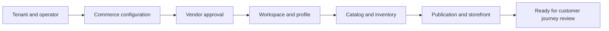

## Launch order

1. Platform staff establish the tenant and its operator access.
2. Tenant operators review store identity, currency/tax, payment and shipping configuration.
3. Establish vendor organizations and approve the intended tenant-vendor links.
4. Vendor staff choose the approved workspace and maintain required profile/destination information.
5. Tenant/vendor teams prepare categories, brands, attributes, variants, prices and stock.
6. Review product publication/moderation, storefront content and navigation.
7. Inspect the customer journey through discovery and purchase screens. Perform a purchase only in an explicitly authorized test/payment environment.

## Connect the steps to the screen

<SystemTour tour="products" compact />

## Readiness is several checks

A vendor account can exist before approval. A product can be saved before publication. A visible product can lack available stock. A configured gateway can still reject the purchase currency. A payout account can exist without verification. Review each dependency through its own status and evidence.

See [tenants](/en/features/tenants), [vendors](/en/features/vendors), [products](/en/features/products), [inventory](/en/features/inventory) and [payments](/en/features/payments).
